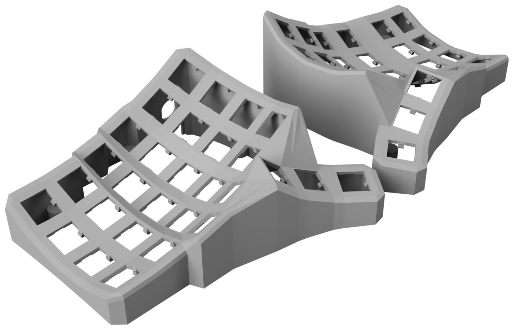

# Tightyl Keyboard



This is a fork of the [Tightyl](https://github.com/okke-formsma/dactyl-manuform-tight), which is a variation of the [Dactyl-ManuForm](https://github.com/tshort/dactyl-keyboard) with a smaller desk footprint (also faster to print) and simpler 3-key thumb cluster.

## Repository Structure

```text
├── img/            # Images
├── qmk/            # QMK firmware & layouts
├── src/            # Case generator code
└── things/         # Printable 3D meshes
```

## Changelog

I only made small changes to the original Tightyl design: completely preserving the exterior, but made some tweaks to make it easier to print on my 3d printer. Changes are documented below.

 - Added a GX12 mount hole; can be modified for any other panel mount connectors (e.g. GX16) *(trrs might short the microcontroller when hotplugging)*
 - Added a holder for a raspberry pi pico (or clones)
 - Made walls thicker *(the original had thin wall print defects near the thumb cluster; at the sharp angle of the base and the topmost horn)*
 - Moved bottom screw posts to connect to the walls, and made them thicker and more robust

## How to Customise the Case

### Required Software

You need to install OpenSCAD and Clojure

- For OpenSCAD, follow the instructions at [https://openscad.org/downloads.html](https://openscad.org/downloads.html)
- For Clojure on Windows, I recommend following [https://github.com/littleli/scoop-clojure/wiki/Getting-started](https://github.com/littleli/scoop-clojure/wiki/Getting-started)

### Edit Configuration

To edit the layout, open `src/dactyl.clj` in a text editor and edit the code.

You'll probably want to change:
 - `(def nrows 5)`, `(def ncols 6)`: for the number of keys
 - `(def create-side-nubs? true)`: if you're using Kailh switches instead of Cherry MX or Gateron
 - `things\holder.stl`: if you're using another microcontroller (e.g. lolligag's pro-micro holder)
 - `things\interconnect.stl`: if you're using something other than GX12 for your inter-half connections

### Generate 3D Models

 - Run `lein repl`
 - In the repl run `(load-file "src/dactyl.clj")`
 - This will regenerate the `things/*.scad` files
 - Use OpenSCAD to open a `.scad` file.
 - Make changes to design, repeat `load-file`, OpenSCAD will watch for changes and rerender.
 - When done, open the desired file in OpenSCAD, press F6 to render, then export to STL files

### Output Files

 - `assembly.scad`: full assembly of the case, keyswitches, microcontroller holder, and i2c connector
 - `right.scad`: case of the right half
 - `right_plate.scad`: bottom plate of the right half
 - `thumb.scad`: just the thumb cluster (for testing)

For the left half, just mirror the right half in your slicer software.

## How to Assemble

1. Print the case parts in a 3D printer.
2. Add M3 heat set inserts to the circular posts at the bottom of the case
3. Install the switches into the case, and wire it up following `/qmk/keyboard.json`.
4. Flash the qmk firmware into the micronctoller. Instructions are in `qmk/readme.md`.

## License

Copyright © 2015-2023 Matthew Adereth, Tom Short, Leo Lou, Okke Formsma, Billy Lim

The source code for generating the models is distributed under the [GNU AFFERO GENERAL PUBLIC LICENSE Version 3](LICENSE).

The generated models are distributed under the [Creative Commons Attribution-ShareAlike 4.0 International (CC BY-SA 4.0)](LICENSE-models).
